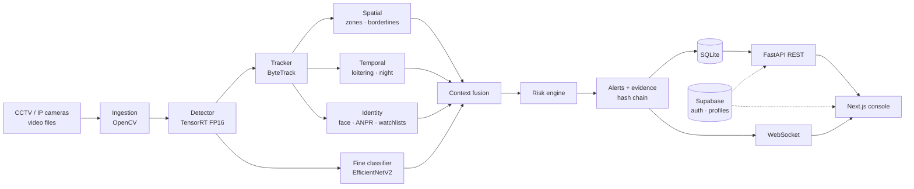

<div align="center">

# IBVAP — Intelligent Border Video Analytics Platform

**Turns existing CCTV and IP cameras into an AI surveillance system that detects, tracks and risk-scores security events in real time.**

[](https://github.com/VenomDevX/IBVAP/actions/workflows/ci.yml)


Smart India Hackathon 2026 · Problem Statement **26187**

</div>

---

## Table of contents

- [Overview](#overview)
- [Key features](#key-features)
- [Architecture](#architecture)
- [Model performance](#model-performance)
- [Tech stack](#tech-stack)
- [Getting started](#getting-started)
- [Configuration](#configuration)
- [Security](#security)
- [Testing and CI](#testing-and-ci)
- [Training the models](#training-the-models)
- [Repository layout](#repository-layout)
- [Troubleshooting](#troubleshooting)
- [Documentation](#documentation)

## Overview

Border posts already have cameras, but a human cannot watch dozens of feeds at once. IBVAP runs every feed through a GPU vision pipeline and shows operators only what matters.

Its core idea is **context fusion**. Instead of raising an alert for every raw detection, IBVAP combines spatial, temporal, behavioural and identity signals for each tracked object into **one explainable, risk-scored event**. For example: *"person near the fence at night, loitering 90 s, moving toward a restricted zone"* becomes a single high-risk event, not four separate alerts.

## Key features

| Area | What it does |
|---|---|
| **Video ingestion** | RTSP / IP camera streams and recorded video files, with automatic reconnect and a watchdog for stale feeds |
| **Detection** | Custom 13-class detector (people, vehicles, licence plates, military vehicles, aircraft, helicopters, drones, animals, night-vision objects), exported to TensorRT FP16 and batched across cameras on the GPU |
| **Fine classification** | Second-stage EfficientNetV2 classifier names the specific type of military detections (29 classes) |
| **Tracking** | Persistent IDs and trajectories with ByteTrack |
| **Spatial rules** | Polygon zones (restricted / buffer), **virtual borderlines** with crossing direction, approach detection, heatmaps |
| **Temporal rules** | Loitering (dwell time) and night / low-light context |
| **Identity** | Face recognition (InsightFace on ONNX Runtime GPU) and number-plate reading (PaddleOCR) with Indian plate-format validation |
| **Watchlists** | Plate and face watchlists that raise alerts on a match |
| **Risk scoring** | Explainable weighted score across spatial, temporal, behavioural, identity and visual factors, in four levels |
| **Alerts** | Deduplication, per-camera rate limits, live WebSocket push, and optional email (SMTP) and SMS (Twilio) for critical alerts |
| **Evidence** | Snapshots and video clips with SHA-256 hashes, plus an HMAC hash chain over events and alerts that makes tampering detectable |
| **Operator console** | Live dashboard, multi-camera grid (remembers each user's layout), map view, alerts and incident workflow, events, zones, audit log, reports |
| **Access control** | Supabase sign-in, role-based access (admin, commander, supervisor, operator, auditor, viewer), per-user camera scopes, and TOTP two-step verification |

## Architecture



The system has three parts:

- **`backend/`** is a FastAPI service that runs the vision pipeline and serves the REST, streaming and WebSocket APIs. SQLite (via SQLAlchemy) stores cameras, tracks, events, alerts, zones and the audit log.
- **`frontend/`** is the operator console: Next.js 16 as a static export, with React 19 and Tailwind CSS v4.
- **`supabase/`** holds authentication and user profiles (roles, camera scopes, two-step verification setting) in Postgres, locked down with row-level security. See [ADR-001](docs/ADR-001-datastore.md) for why data is split this way.

## Model performance

The coarse detector was trained at 640 px for 50 epochs. Evaluation on the held-out validation split:

| Metric | Value |
|---|---|
| Precision | 0.759 |
| Recall | 0.695 |
| Macro F1 | 0.715 |
| mAP@50 | **0.727** |
| mAP@50–95 | 0.523 |

<details>
<summary>Per-class mAP@50</summary>

| Class | mAP@50 | Class | mAP@50 |
|---|---|---|---|
| licence plate | 0.950 | person | 0.716 |
| car | 0.905 | animal | 0.656 |
| bicycle | 0.858 | night-vision object | 0.634 |
| drone / UAV | 0.826 | bus | 0.632 |
| military ground vehicle | 0.812 | aircraft | 0.530 |
| motorcycle | 0.789 | helicopter | 0.379 |
| truck | 0.768 | | |

</details>

Reproduce with `python -m ml.eval_detector --weights models/ibvap_coarse.pt` (from `backend/`).

## Tech stack

| Layer | Technology |
|---|---|
| Vision | Ultralytics YOLO · TensorRT · PyTorch 2.14 (CUDA 12.6) · timm (EfficientNetV2) · ByteTrack (`supervision`) · OpenCV |
| Identity | InsightFace on ONNX Runtime GPU · PaddleOCR |
| Backend | Python 3.11 · FastAPI · Uvicorn · SQLAlchemy 2 (SQLite) · slowapi |
| Auth | Supabase Auth (JWT, TOTP MFA) · Postgres row-level security |
| Frontend | Next.js 16 · React 19 · TypeScript 5.9 · Tailwind CSS v4 · Recharts · Leaflet |
| Tooling | pytest · ruff · Bandit · Semgrep · pip-audit · Vitest · Playwright · oxlint |
| Deployment | Docker Compose (optional GPU and TLS overlays) · nginx |

## Getting started

### Prerequisites

- **Windows 10/11 or Linux**, Python **3.11**, Node.js **20+**
- **Docker Desktop** and the **Supabase CLI** (run through `npx`) for local authentication
- **NVIDIA GPU** recommended (developed on an RTX 4050, 6 GB, with driver ≥ 560). The pipeline also runs on CPU, but more slowly.
- About **16 GB RAM**. Each enabled camera decodes its own video stream.

### Option A — one-click start (Windows)

After the one-time setup below, a single command starts Docker, Supabase, the backend (port **8002**) and the frontend (port **3001**), and opens the browser:

```powershell
.\start-ibvap.bat
# or: powershell -ExecutionPolicy Bypass -File scripts\start-ibvap.ps1 [-Rebuild] [-NoBrowser]
```

### Option B — manual setup

**1. Authentication (Supabase)**

```bash
npx supabase start            # local auth + Postgres on :54321, applies supabase/migrations
```

**2. Backend**

```bash
python -m venv .venv
.venv\Scripts\activate                      # Linux/macOS: source .venv/bin/activate
cd backend
pip install -r requirements.txt
pip install -r requirements-cuda.txt        # NVIDIA GPU: CUDA PyTorch, ONNX Runtime GPU, TensorRT
cp .env.example .env                        # then fill in the values (see Configuration)
python scripts/seed_users.py --defaults     # creates admin@ibvap.local and operator@ibvap.local
python main.py --port 8002
```

**3. Frontend**

```bash
cd frontend
npm ci
# create .env with NEXT_PUBLIC_SUPABASE_URL and NEXT_PUBLIC_SUPABASE_ANON_KEY
# (both are printed by `npx supabase status`)
npm run build                 # static export to out/
node scripts/serve-static.mjs # http://localhost:3001  (or `npm run dev` while editing)
```

Open **http://localhost:3001** and sign in. On first sign-in you'll be asked to set up two-step verification with an authenticator app (Google Authenticator, Microsoft Authenticator or Authy).

### Option C — Docker Compose

```bash
docker compose up --build                                               # CPU
docker compose -f docker-compose.yml -f docker-compose.gpu.yml up --build   # NVIDIA GPU
```

See [docs/DEPLOYMENT.md](docs/DEPLOYMENT.md) for TLS and production settings.

## Configuration

### Environment (`backend/.env`)

| Variable | Purpose |
|---|---|
| `IBVAP_ENV` | `development` (API docs at `/docs`) or `production` (docs off) |
| `SUPABASE_URL`, `SUPABASE_KEY`, `SUPABASE_SERVICE_KEY`, `SUPABASE_JWT_SECRET` | Token verification and role lookup |
| `DATABASE_URL` | Defaults to `sqlite:///./ibvap.db` |
| `IBVAP_ADMIN_PASSWORD`, `IBVAP_OPERATOR_PASSWORD` | Passwords for the seeded accounts. There are no built-in default credentials. |
| `CORS_ORIGINS`, `TRUSTED_HOSTS` | Comma-separated allow-lists |
| `SMTP_*`, `TWILIO_*` | Optional critical-alert notifications |

### Surveillance setup (`backend/configs/`)

| File | Controls |
|---|---|
| `cameras.yaml` | Camera IDs, names, sources (RTSP URL or video file), resolution, FPS |
| `zones.yaml` | Restricted / buffer zones (polygons) and virtual borderlines (two points, direction, classes) |
| `thresholds.yaml` | Detector confidence, per-class thresholds, device, face / ANPR / classifier settings, alert limits |
| `risk_weights.yaml` | Risk-engine weights and score tables |

Zone and fence coordinates are in the camera's configured frame resolution (for example 1920 × 1080). Cameras can also be turned on or off from the console, and that choice persists across restarts.

## Security

- **Authentication:** Supabase JWTs are verified on every request, and a server-side denylist makes logout actually revoke the token.
- **Two-step verification:** TOTP is on for every account by default. Admins can exempt individual users under **Settings → Users**, and every change is audited. The API refuses password-only sessions unless the user is exempt, and database row-level security requires the second factor for admin writes.
- **Authorisation:** role guards on every route, plus per-user camera scopes for listings, streams and evidence.
- **Hardening:** security headers, rate limiting, input validation, trusted-host and CORS allow-lists, and path-traversal protection on media routes.
- **Evidence integrity:** SHA-256 on every snapshot and clip. `backend/scripts/verify_evidence_chain.py` checks the HMAC chain for tampering.
- **Audit log:** records who changed what (cameras, zones, users, security settings).

See [docs/SECURITY_AUDIT_2026-09-08.md](docs/SECURITY_AUDIT_2026-09-08.md) and [docs/SECRET_ROTATION.md](docs/SECRET_ROTATION.md).

## Testing and CI

```bash
# backend (from backend/)
pytest -q
ruff check src scripts ml && ruff format --check src scripts ml tests
bandit -r src ml -c bandit.yaml -q

# frontend (from frontend/)
npm run typecheck && npx oxlint && npm test
npx playwright test          # end-to-end; needs the stack running on :3001
```

GitHub Actions ([`ci.yml`](.github/workflows/ci.yml)) runs backend lint and tests, the frontend type check and build, and a security job (Bandit, Semgrep, pip-audit, npm audit) on every push and pull request.

## Training the models

Training is separate from the running app. The scripts write to `backend/outputs/`, and `main.py` never runs them. The full walkthrough is in [docs/RUNBOOK_LOCAL_TRAINING.md](docs/RUNBOOK_LOCAL_TRAINING.md). In short, from `backend/`:

```bash
python -m ml.remap_to_coarse                                    # build the 13-class dataset
python scripts/make_clean_split.py --src data/detector_yolo     # leak-free, clip-aware split
python -m ml.verify_dataset --data configs/dataset_coarse.yaml  # class balance / leakage gate
python scripts/train_yolo.py --data configs/dataset_coarse.yaml # train the detector
python -m ml.eval_detector --weights outputs/training/ibvap_coarse/weights/best.pt
python scripts/export_tensorrt.py                               # FP16 TensorRT engine for the GPU
```

The detector's class list lives in one place: [`backend/ml/taxonomy.py`](backend/ml/taxonomy.py).

## Repository layout

```
├── backend/
│   ├── main.py              # API + pipeline entry point
│   ├── configs/             # cameras, zones, thresholds, risk weights, datasets
│   ├── src/
│   │   ├── ingestion/       # video sources, reconnect, watchdog
│   │   ├── detection/       # batched YOLO / TensorRT detector
│   │   ├── classification/  # second-stage fine classifier
│   │   ├── tracking/        # ByteTrack
│   │   ├── spatial/         # zones, virtual borderlines, direction, heatmaps
│   │   ├── temporal/        # loitering, night context
│   │   ├── face/  anpr/     # face recognition, plate reading
│   │   ├── watchlist/       # plate and face watchlists
│   │   ├── behavior/  fusion/  risk/
│   │   ├── alerts/          # alerts, evidence, clips, hash chain, notifiers
│   │   ├── database/        # SQLAlchemy models + repository
│   │   ├── api/             # FastAPI app, routes, auth, middleware, WebSocket
│   │   └── pipeline/        # per-camera and master pipelines
│   ├── ml/                  # dataset prep and evaluation
│   ├── scripts/             # training, export, seeding, verification
│   └── tests/
├── frontend/
│   ├── app/                 # dashboard, multiview, map, alerts, events, cameras,
│   │                        #   zones, watchlists, audit, settings, login
│   ├── src/                 # components, API client, auth context, hooks
│   └── tests/               # Vitest unit tests, Playwright e2e
├── supabase/                # config + migrations (profiles, RLS, MFA)
├── scripts/                 # start-ibvap.ps1 launcher, local helpers
├── docs/                    # PRD, TRD, ADRs, deployment, security, runbooks
└── docker-compose*.yml      # base, GPU and TLS overlays
```

## Troubleshooting

| Symptom | Cause and fix |
|---|---|
| Sign-in fails and nothing answers on `:54321` after a reboot | Windows reserved a port range that includes 54321. In an **admin** PowerShell run `net stop winnat; net start winnat`, then `npx supabase stop && npx supabase start`. |
| Detections stop and the log shows `CUDA error: out of memory` while the GPU still has free memory | Windows is out of commit memory (RAM + page file). Close heavy apps or disable some cameras, then restart the backend. A larger page file prevents it. |
| Backend health says `degraded` right after start | Cameras and models load in the background. Wait until `/api/health` reports `"ready": true`. |

## Documentation

| Document | Contents |
|---|---|
| [IBVAP_PRD.md](docs/IBVAP_PRD.md) | Product requirements, MVP scope, operator workflows, success metrics |
| [IBVAP_TRD.md](docs/IBVAP_TRD.md) | Architecture, models, dataset strategy, database, API |
| [ADR-001-datastore.md](docs/ADR-001-datastore.md) | Why SQLite for app data and Supabase for identity |
| [DEPLOYMENT.md](docs/DEPLOYMENT.md) | Docker, GPU, TLS and production configuration |
| [RUNBOOK_LOCAL_TRAINING.md](docs/RUNBOOK_LOCAL_TRAINING.md) | Rebuilding the dataset and training on a local GPU |
| [SECURITY_AUDIT_2026-09-08.md](docs/SECURITY_AUDIT_2026-09-08.md) | Security review and the fixes applied |

---

<div align="center">
Built for <b>Smart India Hackathon 2026</b> · Problem Statement 26187
</div>
